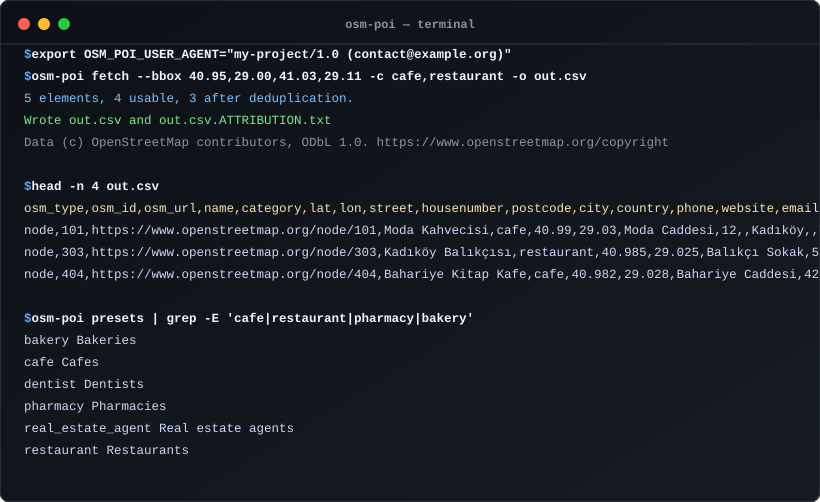

# osm-poi

[](https://github.com/YusufBeratZengin/osm-poi/actions/workflows/ci.yml)
[](https://pypi.org/project/osm-poi/)
[](https://www.python.org/downloads/)
[](https://opensource.org/licenses/MIT)

> OpenStreetMap üzerindeki ilgi noktalarını (işletmeler, hizmetler, dükkânlar) kategori ön ayarları, nazik hız sınırları ve otomatik tekilleştirme ile CSV, GeoJSON veya JSONL olarak dışa aktarır.

<p align="center">
  
</p>

## Neden osm-poi?

- **Sıfır ücretli API bağımlılığı**: Pahalı Google Places veya Mapbox faturalarına gerek duymadan; doğrudan herkese açık Overpass API ve Nominatim üzerinden işletme ve POI verilerini Python standart kütüphanesi dışında hiçbir bağımlılık olmadan ücretsiz ve yasal olarak çeker.
- **Üretime hazır veri temizliği ve tekilleştirme**: Düğüm (node), yol (way) ve ilişkileri (relation) tarar; CSV formül enjeksiyonu risklerini temizler; telefon ve web adreslerini düzenler; bina çevre çizgileri ile nokta kayıtlarını (75 m içinde) akıllıca tekilleştirir.
- **Kuralcı, nazik ve mevzuata duyarlı**: Sunucuları koruyan istek aralıkları, üstel geri çekilme, alan boyutu güvenlik sınırı (`--max-area`) ve kutu bölme (`--split`) ile çalışır. ODbL atıf dosyasını otomatik üretir ve KVKK/GDPR uyumu için gizlilik bayrağı (`--no-contact`) sunar.

## Özellikler

- **Esnek alan girişi**: Sınırlayıcı kutu (`--bbox`), Nominatim ile çözülen idari bölge adı (`--area`) veya GeoJSON poligon dosyası (`--polygon`). Tek çalıştırmada birden fazla alan birleştirilebilir.
- **Zengin kategori ön ayarları**: Düz JSON dosyasında tanımlı 40'tan fazla hazır ön ayar (`cafe`, `restaurant`, `pharmacy`, `dentist`, `real_estate_agent`, `estate_agent`, `hairdresser`, `hotel`, `stationery`, `notary`, `car_repair`, `supermarket` vb.).
- **Eksiksiz geometri desteği**: Nokta (node), çizgi/alan (way) ve ilişkiler (relation) sorgulanır; alan ve ilişkilerde merkez koordinat hesaplanır.
- **Düzenlenmiş çıktı şeması**: `osm_type, osm_id, osm_url, name, category, lat, lon, street, housenumber, postcode, city, country, phone, website, email, opening_hours`.
- **Mekânsal tekilleştirme (Deduplication)**: Aynı ad ve kategoriye sahip, 75 metre mesafedeki kopyaları (örneğin bina çizimi ile işletme noktası) birleştirir (`--dedupe-radius` ile ayarlanabilir).
- **Sunucu güvenlik kalkanı**: Kamusal Overpass sunucularını korumak için varsayılan olarak 0.25 derece kare üzerindeki alanları durdurur; `--split N` ile büyük alanları alt parçalara bölerek sorgular.
- **Gizlilik ve uyumluluk kontrolleri**: `--no-contact` seçeneği telefon, web sitesi ve e-posta sütunlarını kaldırır; `--fields` ile yalnızca istenen sütunlar seçilebilir.
- **Çoklu çıktı biçimleri**: Temiz CSV (elektronik tablo formül enjeksiyonuna karşı korumalı), GeoJSON FeatureCollection veya satır satır JSONL.
- **Nazik ağ yönetimi**: Zorunlu User-Agent kimliği, istekler arasında otomatik bekleme, 429/5xx hatalarında üstel geri çekilme ve yerel disk önbelleği.
- **Kuru çalıştırma (dry-run)**: `--dry-run` sunucuya istek göndermeden oluşturulan Overpass QL sorgusunu ekrana basar.
- **Otomatik ODbL atfı**: Her çıktı dosyasının yanına lisans atıf metnini iliştirir.

## Hızlı başlangıç

### Kurulum

```bash
pip install osm-poi
```

Python 3.10 veya daha yeni bir sürüm gereklidir.

### Kimlik Tanımlama

Overpass ve Nominatim, uygulamanızı tanıtmanızı ve iletişim bilgisi sağlamanızı şart koşar:

```bash
# Linux / macOS
export OSM_POI_USER_AGENT="my-project/1.0 (contact@example.org)"

# PowerShell
$env:OSM_POI_USER_AGENT = "my-project/1.0 (contact@example.org)"
```

### Temel Komutlar

```bash
# Kadıköy'deki kafe ve restoranları CSV'ye aktar
osm-poi fetch --area "Kadikoy, Istanbul" --category cafe,restaurant -o out.csv

# Sınırlayıcı kutu ile eczaneleri GeoJSON olarak al
osm-poi fetch --bbox 40.95,29.00,41.03,29.11 -c pharmacy -o pharmacies.geojson

# GeoJSON poligonu içindeki diş hekimlerini JSONL'e yaz
osm-poi fetch --polygon district.geojson -c dentist -f jsonl -o dentists.jsonl

# Ağ isteği yapmadan üretilen Overpass sorgusunu incele
osm-poi fetch --bbox 40.95,29.00,41.03,29.11 -c cafe --dry-run

# Mevcut tüm ön ayarları listele
osm-poi presets
```

`--bbox` standard Overpass koordinat sırasını izler: `güney,batı,kuzey,doğu` (`south,west,north,east`). Çıktı biçimi dosya uzantısından (`.csv`, `.geojson`/`.json`, `.jsonl`) otomatik anlaşılır ya da `--format` ile belirtilir. Varsayılan olan `-o -` çıktıyı doğrudan ekrana yazar.

### Çıktı Sütunları

`osm_type, osm_id, osm_url, name, category, lat, lon, street, housenumber, postcode, city, country, phone, website, email, opening_hours`

Adı olmayan kayıtlar `--include-unnamed` verilmedikçe elenir. Eksik değerler boş metin olarak döndürülür.

## Kullanım örnekleri

### Kadıköy Uygulamalı Örneği

Bu Kadıköy örneğinde kafe ve restoranlar sorgulandığında OpenStreetMap'ten 5 ham kayıt gelir: birbirine 25 metre mesafede "Moda Kahvecisi"ne ait bir nokta (node) ile bir bina çevresi (way), bir balık restoranı ("Kadıköy Balıkçısı"), bir kitap kafe ("Bahariye Kitap Kafe") ve adı olmayan bir kafe noktası.

1. **İsimsiz kayıtların filtrelenmesi**: Adı olmayan kayıtlar varsayılan olarak atlanır ve isimsiz kafe elenir.
2. **Tekilleştirme (Deduplication)**: 75 metre mesafe içinde aynı düzenlenmiş ada ("moda kahvecisi") sahip bina çizimi ve nokta tespit edilir. Daha eksiksiz iletişim ve adres bilgisi içeren nokta kaydı muhafaza edilip kopya çizim birleştirilir.
3. **Temiz sonuç**: Sonuçta tam olarak 3 tekilleştirilmiş işletme kaydı üretilir.

### CSV Çıktı Kesiti

```csv
osm_type,osm_id,osm_url,name,category,lat,lon,street,housenumber,postcode,city,country,phone,website,email,opening_hours
node,101,https://www.openstreetmap.org/node/101,Moda Kahvecisi,cafe,40.99,29.03,Moda Caddesi,12,,Kadıköy,TR,+90 216 555 0101,https://example.org/moda,,Mo-Su 08:00-22:00
node,303,https://www.openstreetmap.org/node/303,Kadıköy Balıkçısı,restaurant,40.985,29.025,Balıkçı Sokak,5,,Kadıköy,TR,+90 216 555 0102,https://example.org/balik,,Tu-Su 12:00-23:00
node,404,https://www.openstreetmap.org/node/404,Bahariye Kitap Kafe,cafe,40.982,29.028,Bahariye Caddesi,42,,Kadıköy,TR,+90 216 555 0103,https://example.org/kitap,,Mo-Sa 09:00-21:00
```

### GeoJSON Özellik Kesiti

```json
{
  "type": "Feature",
  "id": "node/101",
  "geometry": {
    "type": "Point",
    "coordinates": [
      29.03,
      40.99
    ]
  },
  "properties": {
    "osm_type": "node",
    "osm_id": 101,
    "osm_url": "https://www.openstreetmap.org/node/101",
    "name": "Moda Kahvecisi",
    "category": "cafe",
    "street": "Moda Caddesi",
    "housenumber": "12",
    "postcode": "",
    "city": "Kadıköy",
    "country": "TR",
    "phone": "+90 216 555 0101",
    "website": "https://example.org/moda",
    "email": "",
    "opening_hours": "Mo-Su 08:00-22:00"
  }
}
```

### JSONL Çıktı Kesiti

```jsonl
{"osm_type": "node", "osm_id": 101, "osm_url": "https://www.openstreetmap.org/node/101", "name": "Moda Kahvecisi", "category": "cafe", "lat": 40.99, "lon": 29.03, "street": "Moda Caddesi", "housenumber": "12", "postcode": "", "city": "Kadıköy", "country": "TR", "phone": "+90 216 555 0101", "website": "https://example.org/moda", "email": "", "opening_hours": "Mo-Su 08:00-22:00"}
```

Örnek veri setlerinin tamamı, özel ön ayar tanımları, poligon dosyaları ve çalıştırılabilir Python betiği için [examples/](examples/) dizinini inceleyebilirsiniz.

### Python API

`osm-poi` paketini Python kodlarınızın içinde doğrudan bir kütüphane olarak kullanabilirsiniz:

```python
from osm_poi import Poi, fetch_pois

pois = fetch_pois(
    bbox="40.95,29.00,41.03,29.11",
    categories=["cafe", "restaurant"],
    user_agent="my-app/1.0 (contact@example.org)",
)

for poi in pois:
    print(f"{poi.name} ({poi.category}) - {poi.lat}, {poi.lon} - {poi.phone or 'telefon yok'}")
```

`__all__` listesinde sunulan genel sınıf ve fonksiyonlar:
- `fetch_pois`: Tek çağrıda POI'leri çeker, düzenler ve tekilleştirir.
- `Poi`: Tip korumalı POI veri sınıfı.
- `BBox`, `Polygon`: Mekânsal sınır nesneleri.
- `Config`, `load_config`: Yapılandırma yönetimi.

## Ön ayarlar

Tüm ön ayarları `osm-poi presets` ile listeleyebilirsiniz. Özel ön ayarlar tanımlamak ya da mevcutları geçersiz kılmak için `--presets-file ozel_ayarlar.json` seçeneğini kullanın:

```json
{
  "bike_shop": {
    "label": "Bisiklet dükkanları",
    "tags": [{"shop": "bicycle"}]
  },
  "bar": {
    "label": "Barlar ve publar",
    "tags": [{"amenity": ["bar", "pub", "biergarten"]}]
  }
}
```

`tags` bir etiket kümeleri listesidir. Bir kayıt, kümelerden herhangi biriyle eşleşirse ön ayara uyar; bir küme içinde tüm anahtarlar eşleşmelidir. Değer; bir metin, seçenek listesi ya da "anahtar var mı" anlamına gelen `"*"` olabilir.

## Yapılandırma

Öncelik sırası (düşükten yükseğe): varsayılanlar, JSON yapılandırma dosyası, ortam değişkenleri, komut satırı seçenekleri.

| Ayar | Ortam değişkeni | Seçenek | Varsayılan |
|---|---|---|---|
| `user_agent` | `OSM_POI_USER_AGENT` | `--user-agent` | yok (zorunlu) |
| `overpass_url` | `OSM_POI_OVERPASS_URL` | `--overpass-url` | `https://overpass-api.de/api/interpreter` |
| `nominatim_url` | `OSM_POI_NOMINATIM_URL` | `--nominatim-url` | `https://nominatim.openstreetmap.org` |
| `timeout` | `OSM_POI_TIMEOUT` | `--timeout` | 90 saniye |
| `retries` | `OSM_POI_RETRIES` | `--retries` | 3 |
| `backoff` | `OSM_POI_BACKOFF` | | 2 saniye, her denemede ikiye katlanır |
| `overpass_interval` | `OSM_POI_OVERPASS_INTERVAL` | | istekler arası 1 saniye |
| `nominatim_interval` | `OSM_POI_NOMINATIM_INTERVAL` | | istekler arası 1 saniye |
| `cache_dir` | `OSM_POI_CACHE_DIR` | `--cache-dir` | kullanıcı önbellek dizini |
| `cache_ttl_hours` | `OSM_POI_CACHE_TTL_HOURS` | `--cache-ttl-hours` | 168 |
| `use_cache` | `OSM_POI_USE_CACHE` | `--no-cache` | açık |
| `max_area` | `OSM_POI_MAX_AREA` | `--max-area` | 0.25 derece kare |

### Komut Satırı Seçenekleri

- `--no-contact`: Telefon, web sitesi ve e-posta sütunlarını çıktıdan kaldırır.
- `--fields LIST`: Dışa aktarılacak sütunların listesi (örn. `--fields name,category,lat,lon`).
- `--allow-large`: Alan boyutu güvenlik sınırını devre dışı bırakır.
- `--split N`: Sınırlayıcı kutuyu $N \times N$ parçaya bölerek sıralı ve aralıklı alt sorgular gönderir.

Yapılandırma dosyası sırasıyla `--config`, `OSM_POI_CONFIG` ya da `~/.config/osm-poi/config.json` (Windows'ta `%APPDATA%\osm-poi\config.json`) yolunda aranır.
Önbellek durumunu `osm-poi cache path` ve `osm-poi cache clear` ile yönetebilirsiniz.

## Sorumlu kullanım

OpenStreetMap verileri topluluk gönüllüleri tarafından girilmekte ve güncellenmektedir. İşletme kayıtları çoğunlukla açık iletişim bilgileri içerse de şu hususlara dikkat edilmelidir:

- **Gizlilik seçenekleri**: `--no-contact` bayrağı ile `phone`, `website` ve `email` sütunlarını çıktıdan tamamen kaldırabilir veya `--fields name,category,lat,lon` ile yalnızca istediğiniz sütunları seçebilirsiniz.
- **Kişisel verilerin korunması (KVKK / GDPR)**: Şahıs şirketleri, serbest meslek mensupları veya bireysel uzmanlarla ilişkili iletişim bilgileri 6698 sayılı Kişisel Verilerin Korunması Kanunu (KVKK) ve Avrupa Genel Veri Koruma Tüzüğü (GDPR) kapsamında kişisel veri niteliği taşıyabilir.
- **Elektronik ticari ileti ve spam mevzuatı**: İstenmeyen ticari iletiler (onaysız soğuk e-posta, otomatik arama veya SMS) 6563 sayılı Elektronik Ticaretin Düzenlenmesi Hakkında Kanun ve Ticari Elektronik İleti Yönetim Sistemi (İYS) düzenlemelerine tabidir.
- **Yasal sorumluluk**: Bu dokümantasyon bir hukuki görüş değildir. Veri toplama ve iletişim süreçlerinizin yürürlükteki mevzuata uygunluğunu değerlendirmek kullanıcının sorumluluğundadır.

## Kullanım politikaları

- [Nominatim kullanım politikası](https://operations.osmfoundation.org/policies/nominatim/): Saniyede en çok bir istek, geçerli bir User-Agent, önbelleğe alınmış sonuçlar ve toplu coğrafi kodlama yasağı. osm-poi her `--area` için tek sorgu gönderir ve sonucu önbelleğe alır. Herkese açık sunucuyu büyük toplu işler için kullanmayın.
- [Overpass API politikası](https://wiki.openstreetmap.org/wiki/Overpass_API#Public_Overpass_API_instances): Herkese açık sunucular paylaşılan topluluk altyapısıdır. Sorgu alanlarını makul tutun; yoğun kullanımda `--overpass-url` ile kendi yerel kopyanızı (mirror) hedefleyin.

## Sık Sorulan Sorular ve Kısıtlar

### Sorgulayabileceğim azami alan boyutu nedir?
Kamusal Overpass sunucularına aşırı yük bindirmemek için osm-poi varsayılan olarak 0.25 derece karelik (orta enlemlerde yaklaşık $50 \times 50\text{ km}$) bir güvenlik sınırı uygular. Daha geniş bölgeleri taramak için `--split 2` (veya üzeri) kullanarak alanı alt kutulara bölebilir veya özel bir Overpass sunucusu kullanıyorsanız `--allow-large` bayrağını verebilirsiniz.

### Telefon numarası ve çalışma saatleri her kayıtta garanti midir?
Hayır. OpenStreetMap verileri topluluk katkısıyla oluşturulur. Birçok işletme eksiksiz iletişim ve çalışma saati bilgisine sahip olsa da, bu verilerin doluluğu bölgeye ve yerel haritalama yoğunluğuna göre değişir. Eksik alanlar boş metin olarak döndürülür.

### ODbL lisansı dışa aktardığım verileri nasıl etkiler?
OpenStreetMap verileri Açık Veritabanı Lisansı (ODbL) 1.0 kapsamındadır. Veriyi kullanırken `(c) OpenStreetMap contributors` atfını belirtmeniz gerekir. Veritabanını değiştirip herkese açık olarak yayımlarsanız, türetilen veritabanı da ODbL ile lisanslanmalıdır. Veriyi yalnızca dahili analizlerinde kullanan veya görüntüleyen özel uygulamaların kendi kaynak kodlarını açma zorunluluğu bulunmaz. Ayrıntılar için [OSM Telif Sayfası](https://www.openstreetmap.org/copyright) incelenmelidir.

## Katkıda Bulunma

Katkılarınızı memnuniyetle kabul ediyoruz! Lütfen şu adımları izleyin:

1. Depoyu forklayın ve klonlayın.
2. Geliştirme bağımlılıklarını kurun:
   ```bash
   pip install -e ".[dev]"
   ```
3. Test, lint ve tip denetimi komutlarını çalıştırın:
   ```bash
   python -m pytest
   python -m ruff check .
   python -m ruff format --check .
   python -m mypy src
   ```
4. [Katkı Rehberi](CONTRIBUTING.md) ve [Davranış Kuralları](CODE_OF_CONDUCT.md) belgelerini inceleyin.
5. Değişikliklerinizi çekme isteği (Pull Request) olarak gönderin.

## Lisans

Bu proje MIT Lisansı altında sunulmaktadır — ayrıntılar için [LICENSE](LICENSE) dosyasına bakınız.
Veri (c) [OpenStreetMap katkıcıları](https://www.openstreetmap.org/copyright), ODbL 1.0.
